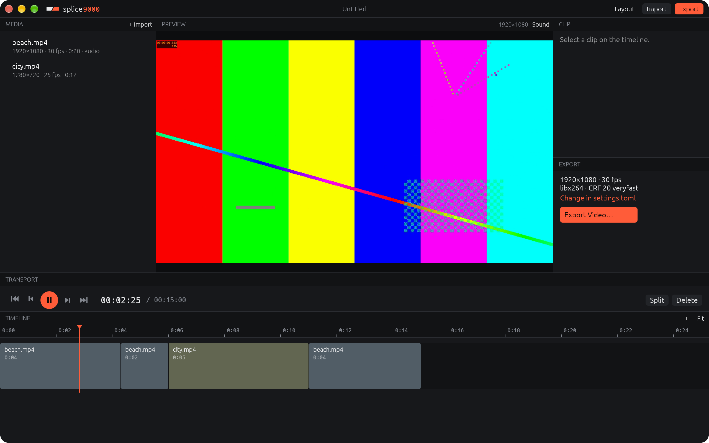

# splice9000

A bare, modular video editor. Drop clips in, cut them on a timeline, export.
Every panel can be moved, added or removed, the way foobar2000 lets you
rearrange its window.



It's a prototype (0.0.1): one video track, cuts and trims, preview with
sound, export. Nothing else is in the app.

## Installing

1. Download `splice9000-<version>-macos-universal.zip` from
   [Releases](https://github.com/solacecasino/splice9000/releases) (Apple
   Silicon and Intel Macs, macOS 11 or later).
2. Unzip it and move splice9000.app to Applications.
3. The first time, **right-click → Open**: the app isn't signed with an Apple
   developer certificate, so macOS asks once.
4. Install [ffmpeg](https://ffmpeg.org) if you don't have it:
   `brew install ffmpeg`. splice9000 runs it as a separate program for
   reading and writing video, so no codecs are built into the editor. If it
   can't find ffmpeg, the Log panel says so and you can set the path in
   `settings.toml`.

**Windows** (x64 and Arm): unzip `splice9000-<version>-windows-<x64|arm64>.zip`
anywhere and run `splice9000.exe`. Windows may warn about an unknown
publisher the first time (the app isn't signed). Put ffmpeg on your PATH
(for example `winget install ffmpeg`).

**Linux** (x64 and Arm): unpack `splice9000-<version>-linux-<x64|arm64>.tar.gz`
and run `./install.sh` inside it to add splice9000 to your app menu
(`./install.sh --remove` takes it out). Install ffmpeg from your
distribution (`sudo apt install ffmpeg`).

Windows and Linux downloads start with 0.0.2; 0.0.1 was Mac only.

## Making a video

1. **Drop video files** anywhere on the window. They're added to Media and to
   the end of the timeline. (Or use **Import…** and double-click or drag media
   onto the timeline.)
2. **Move around**: click or drag on the timeline, `←` `→` for one frame,
   `↑` `↓` for the previous or next cut, `space` to play (with sound; `m`
   mutes). Scroll the timeline
   sideways; `cmd`+scroll or pinch to zoom; `cmd+0` fits the whole edit.
3. **Cut**: `s` splits the clip at the playhead. Drag a clip's edge to trim
   it, drag the clip to move it, `backspace` removes the selected clip.
   Exact in and out points can be typed in the Clip panel. `cmd+z` undoes.
4. **Export**: `cmd+e` (or **Export…**). The output takes the first clip's
   size and frame rate unless `settings.toml` says otherwise; other clips are
   scaled to fit, with black bars where the shape differs.

Your edit is kept as you work and comes back when you reopen splice9000,
even after a crash. `cmd+s` saves it as a `.splice` project file to keep.

## Rearranging the window

Panels sit edge to edge, divided by a single line.

- **Drag the line** between two panels to resize them.
- **Drag a panel by its header** (the slim strip with its name) onto the
  edge of another panel to sit beside it, or onto its middle to swap the two.
- **Right-click a header** to add a panel next to it, replace it, or remove it.
- **View → Panels** shows or hides any panel.
- **Layout** at the top (`cmd+L`) shows every panel as a block to drag, for
  when headers are turned off (`panel_headers = false` in settings.toml).

Panels: Preview, Timeline, Media, Transport, Clip, Export, Log, Help.
A panel can be shown more than once, say two Timelines at different zoom
levels.

The layout is saved to `layout.toml`, which can also be edited by hand.

## Adapters

splice9000 has only what you need, and adapters add the rest. An adapter can
add commands, panels and export formats.

- **Find one** in the [adapter catalog](https://github.com/solacecasino/splice9000-adapters/blob/main/CATALOG.md)
  (**Adapters** at the top right of the window, then **Browse the adapter
  catalog**), download the zip for your computer, and **drop it on the
  window**. There you'll find Silence Cut (jump cuts for talking video),
  Loudness Normalize (exports leveled for YouTube, Spotify, podcasts and
  broadcast) and Scene Split.
  splice9000 shows what it adds and what it may do, and installs it when you
  click **Install**. splice9000 itself never goes online.
- **Seven come built in**, and the editing tools are among them:
  Waveforms and Thumbnails on the timeline, Shuttle (J/K/L playback, up to
  8x either way), Snapping (hold Alt to drag freely), Crossfades
  (Edit → Crossfade at Nearest Cut, ⌘D), Export Presets (YouTube, vertical,
  square, GIF, ProRes, WebM, sound only) and Frame Grab (File → Save Frame
  as PNG, ⌘⇧G). Pick an export format in the Export panel or File → Export
  As. The editing tools are the catalog's, so a newer one installed from
  there takes over.
- **Remove anything you don't need** in the Adapters panel
  (Adapters → Manage). A built-in adapter is then left out completely, and
  Add Back returns it.
- **Make your own** in a few lines of Python, or with no code at all for
  export formats: see [docs/adapters.md](docs/adapters.md) and the
  [template](https://github.com/solacecasino/splice9000-adapters/tree/main/template).

## Menus

File, Edit, View, Playback, Adapters and Help hold every command (and
adapters' commands), with your own
shortcuts from keys.toml. On macOS they're in the system menu bar; on Windows
and Linux, in the strip at the top of the window. The most used tools
(Layout, Import, Export) are also at the top right of the window.

## Customizing

There's no settings window. Everything is in plain text files in one folder
(`cmd+,` opens it):

| File | What it holds |
|---|---|
| `settings.toml` | ffmpeg's path, preview quality, sound and volume, export format and codec, colors |
| `keys.toml` | any key for any command (see the Help panel for the list) |
| `layout.toml` | the panels and where they are |
| `adapters/` | installed adapters (`adapters.toml` lists built-in ones you removed) |

Saved changes apply at once, with no restart. A file with a mistake falls
back to the defaults and the Log panel says what's wrong. Copying the folder
moves your whole setup. Where it is:

- macOS: `~/Library/Application Support/splice9000`
- Windows: `%APPDATA%\splice9000`
- Linux: `~/.config/splice9000`
- or wherever `SPLICE9000_CONFIG_DIR` points

## Measured

On an M-series MacBook (2560×1600 Retina), release build, 2026-10-27:

| | |
|---|---|
| App size | 6.0 MB (ffmpeg not included) |
| Memory, fresh start | 54 MB (physical footprint) |
| Memory, after playing a 4-clip edit with sound | 61 MB |
| CPU when idle, sound device open | 0.0% |
| Playing 1080p in a ~1300×740 preview, 30 fps | splice9000 20–23% of one core, ffmpeg 38% (hardware decoding) |
| Sound while playing | no measurable CPU (23.0% with and without) |
| Drawing one 1.3-megapixel video frame | 2.5–5 ms |
| Showing one frame when scrubbing | about 95 ms |
| Pressing play until the first frame | 90–210 ms (about 320 ms the first time, opening the sound device) |
| Export, 15 s edit of 3 clips at 1080p (libx264, CRF 20, veryfast) | 2.0 s, 7.5× real time |

What changed these numbers, and what didn't work:

- The preview first drew each video frame through the general shape
  renderer, smoothing every pixel: 13 ms a frame. It now decodes frames at
  exactly the size they're shown and copies them straight to the screen:
  2.5–5 ms. (The size was first measured from the panel's outer edge rather
  than the picture's, so frames came out a few pixels too big and missed the
  copy, 11 ms; fixed.)
- CPU figures are measured from CPU time used. An earlier "8% while playing"
  came from `ps`'s %CPU column, which on macOS is a slowly decaying average
  and read low two seconds into playback; it was wrong.
- Frames are read from ffmpeg into memory that isn't cleared first (3.8 MB a
  frame less to write): about one point of CPU, within the noise.
- Adding sound (cpal, muda for the menus, png for the icon) made the app
  0.5 MB bigger.
- Hardware decoding makes a single scrub frame *slower* (260 ms against
  95 ms): starting the decoder costs more than one frame saves. It also
  made every press of play take 420–590 ms to show a picture, against
  125–190 ms in software, for 6 points less CPU while playing (38% against
  44%). It's off by default now (`hwaccel` in settings.toml).
- Pressing play used to stutter: the sound's clock started at once, so the
  frames that arrived while the decoder was starting counted as late and
  were skipped (0.4–0.5 s of picture, then a jump). The clock now starts
  with the first picture, and a frame that arrives after pausing is ignored
  instead of flickering.
- On macOS the window was first drawn into a single shared buffer, as in
  Folio. With video, the system sometimes showed a frame half drawn. There
  are now two buffers that take turns, which costs one more window-sized
  buffer (about 16 MB on this screen).

## Known limits

- Sound plays from the system's default output only, and only while
  playing (not while scrubbing).
- One video track. Crossfades are the only transition; no titles, effects,
  speed changes or keyframes.
- Playing backward (J) shows a picture at a time, about ten a second,
  without sound. Playing faster than real time decodes every frame, so 8x
  of 4K is as fast as the computer can go.
- Scrubbing starts ffmpeg for every frame shown (~95 ms each); fast
  dragging shows fewer frames, never stale ones.
- Used by hand on macOS only. Windows and Linux are built, tested and started
  with a sample edit by CI on every push (screenshots are kept), but not
  used by a person yet. Windows doesn't watch the config folder yet, so
  config changes there apply on the next start.
- Dragging panels and dividers is tested with real pointer input fed through
  egui, not by hand with a mouse. Menu items weren't clicked in testing; the
  menu bar was checked by eye.

## Building

```bash
cargo build --release
```

`cargo test` runs the tests, including a real export through ffmpeg when
it's installed. `scripts/package.sh` makes this system's download in
`dist/`, and `python3 scripts/sample.py <folder>` makes two sample clips and
a session to try the app with.

Every push builds and tests macOS, Windows and Linux on GitHub Actions
(`.github/workflows/release.yml`). To release: bump `version` in
Cargo.toml, write `docs/releases/v<version>.md`, push, then push a tag
`v<version>`; the workflow publishes the release with every download.
